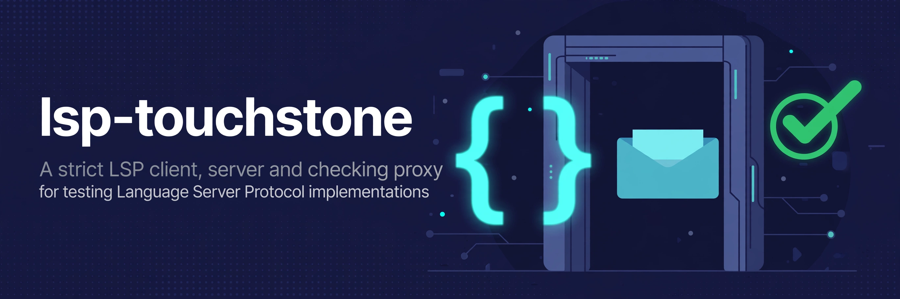

<p align="center">
  
</p>

<p align="center"><strong>Test your language server and your editor against the LSP specification</strong></p>

<p align="center">
  <a href="https://github.com/conao3/rust-lsp-touchstone/actions/workflows/ci.yml"></a>
  <a href="LICENSE"></a>
  <a href="Cargo.toml"></a>
  <a href="spec/README.md"></a>
  <a href="https://github.com/conao3/rust-lsp-touchstone/stargazers"></a>
</p>

<p align="center">
  <a href="#install">Install</a> ·
  <a href="#usage">Usage</a> ·
  <a href="docs/rules.md">Rules</a> ·
  <a href="docs/editors.md">Editors</a> ·
  <a href="#development">Development</a>
</p>

# lsp-touchstone

A touchstone for the Language Server Protocol: a strict client, a strict server and a checking
proxy for testing LSP implementations against the specification.

| Mode | Command | What it tests |
|---|---|---|
| Strict client | `client start-web-ui` | A language server. You drive it from a web UI: send requests, notifications and raw frames, open files, and watch each message and finding live. |
| Checking proxy | `proxy run-proxy` | An editor and a language server together. The proxy sits between them and checks each message on the way. |
| Scoring | `check check-client`, `check check-server`, `check check-record` | A client or a language server in one command, for CI: it runs the session against the strict counterpart and reports each rule, with an exit code and a record that can be scored again. |
| Strict server | `server run-server` | An editor. The server drives it through the server-to-client side of the protocol: progress, dynamic registration, configuration, the negotiated position encoding, each completion item shape and `workspace/applyEdit`. It then checks that the edit the editor applied matches what its next `didChange` produces. |

## What it checks

The three modes share one set of checks, listed with their rules in [docs/rules.md](docs/rules.md):

- framing and JSON-RPC
- the lifecycle around `initialize` and `shutdown`
- params and results against the specification's meta model
- capabilities in both directions
- document synchronization and the positions the server returns
- cancellation and progress

A finding is an error when the specification forbids the behavior, and a warning when the
specification allows more than one reading.

The types and capability bindings come from the specification's `metaModel.json`
([spec/](spec/)). lsp-touchstone embeds the file and interprets it at run time in place
of hand-written types. Lean proves three parts correct through
[lean-rs](https://github.com/conao3/lean-rs): the position encodings, the progress state machine
and the replacement of a changed range.

## Install

lsp-touchstone builds with Nix:

```console
$ nix run github:conao3/rust-lsp-touchstone -- help
$ nix build github:conao3/rust-lsp-touchstone
```

`nix build` puts the executable at `result/bin/lsp-touchstone`.

## Usage

### The strict client

```console
$ lsp-touchstone client start-web-ui --port 4317 --record-file session.ndjson
{"Url":"http://127.0.0.1:4317/"}
```

Open the URL, enter the command of a language server (`rust-analyzer`) and press Start. You can
send requests, notifications or raw frames from templates or by hand, and open files with
`didOpen`. The page shows the messages in both directions, the server's stderr and the findings on
each message as they happen. Selecting a request highlights its response. The client answers
requests from the server (`workspace/configuration`, `window/workDoneProgress/create` and others)
on its own unless you turn auto-respond off.

### The checking proxy

Give an editor this command as its language server:

```console
$ lsp-touchstone proxy run-proxy --web-ui-port 4318 --record-file session.ndjson --server-command-args rust-analyzer
```

The proxy starts the real server, forwards each frame in both directions and checks each message.
It forwards the content of a frame unchanged, with a fresh `Content-Length` header. With
`--web-ui-port` it prints the URL of a watch-only web UI to stderr.

### The strict server

```console
$ lsp-touchstone server run-server --web-ui-port 4319 --record-file session.ndjson
```

Use it as the language server of any file type. The server exercises a feature only when the
editor declared the capability for it. Its code actions run commands that send
`workspace/applyEdit`.

[docs/editors.md](docs/editors.md) has the configuration for eglot, lsp-mode, Neovim, Helix and
VS Code, and what each of them did.

### Scoring a client or a server

```console
$ lsp-touchstone --output table check check-client --record-file client.ndjson --client-command-args opencode debug lsp document-symbols file:///work/sample.tch
$ lsp-touchstone --output table check check-server --record-file server.ndjson --open-file src/main.rs --language-id rust --server-command-args rust-analyzer
$ lsp-touchstone --output table check check-record --record-file client.ndjson
```

`check-client` runs a client that is configured to start `lsp-touchstone server run-server` as
its language server, waits for it to exit and scores every session the strict server recorded. The
strict server finds the record file through the `LSP_TOUCHSTONE_RECORD_FILE` environment variable,
so the client's configuration needs no path. The client's standard output goes to stderr.
`check-server` drives a language server with the strict client: `initialize`, `didOpen` of each
`--open-file`, `documentSymbol` and `hover` when the server declares them, `shutdown` and `exit`.
`check-record` scores a record written by any mode.

Each session in the record is replayed through the checks and ended, so a session whose server
was killed still gets the findings that only its end decides (requests never answered, no
`shutdown`, no `exit`). The report lists every rule of [docs/rules.md](docs/rules.md) with its
count and an outcome: `violated` (an error), `warned` or `no-finding`. A rule with no finding may
not have been exercised. The exit code is 254 when a session has an error.

[docs/agents.md](docs/agents.md) has the configuration for opencode and Claude Code, and what each
of them did.

### GitHub Action

```yaml
- uses: conao3/rust-lsp-touchstone@master
  with:
    mode: server
    command: |
      rust-analyzer
    open-files: src/main.rs
    language-id: rust
```

The action builds lsp-touchstone with Nix, runs `check check-client` (`mode: client`) or
`check check-server` (`mode: server`), writes the table to the job summary and annotates each
finding. `command` takes one argument per line. Inputs: `record-file`
(`lsp-touchstone.ndjson`), `open-files`, `language-id`, `fail-on-error` (`true`) and `install-nix`
(`true`). Outputs: `errors`, `warnings`, `record-file` and `report-file` (the JSON report).
[.github/workflows/action.yml](.github/workflows/action.yml) runs it on the strict server and on
opencode.

### The web UI

The page talks to a GraphQL API at `/api/graphql` ([schema.graphql](schema.graphql)).
Subscriptions use the `graphql-transport-ws` protocol. The server listens on 127.0.0.1 only and
refuses requests whose `Host` or `Origin` is not its own, so other pages in the browser cannot
start processes through it. `--record-file` appends each message as one JSON line.

### Recorded streams

```console
$ lsp-touchstone framing check-frames --input-file recorded-stream.bin
$ lsp-touchstone --output table framing check-frames --input-file /dev/stdin < recorded-stream.bin
```

`check-frames` reads one direction of a recorded stream and reports the findings of each frame.
`--output` takes `json` (default), `text` or `table`.

### Exit codes

| Code | Meaning |
|---|---|
| 0 | No error found |
| 252 | Usage error |
| 254 | The input violates the specification |
| 255 | Any other failure |

## Development

```console
$ nix develop --command make check
$ nix build
$ nix run . -- help
```

`make check` runs the treefmt check, clippy and `cargo test`. `make check-editors` runs eglot,
lsp-mode, Neovim, Helix and VS Code (VSCodium) in the `editors` dev shell, against the strict
server and against rust-analyzer behind the proxy, and prints the findings of each session.

## License

Apache-2.0. `spec/metaModel.json` comes from
[microsoft/vscode-languageserver-node](https://github.com/microsoft/vscode-languageserver-node)
under the MIT License.
